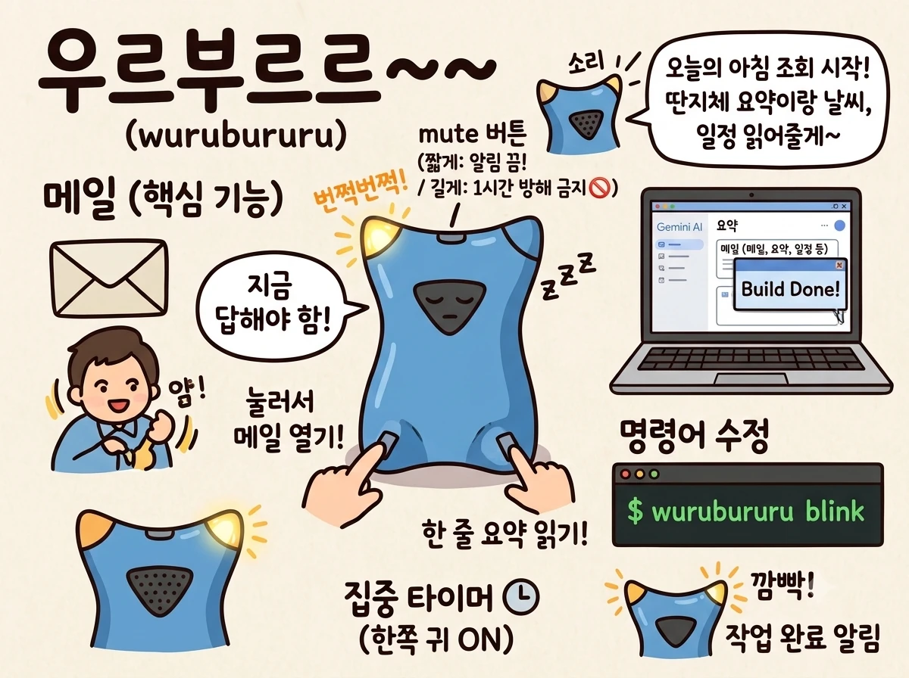

# 우르부르르 (wurubururu)



**우르부르르**는 2001년 딴지일보가 만든 인터넷 라디오 단말 **우르부르(WebToy)** 를 요즘 컴퓨터에서 다시 쓰는 프로그램입니다.
서버는 사라졌지만 기기는 멀쩡합니다. 귀의 LED, 발과 머리의 버튼, 스피커를 직접 제어해서
책상 위 알림 단말로 되살립니다.

- **지원:** macOS (Apple Silicon 포함), Windows 11
- **상태:** 0.2 — macOS에서 실제 기기로 LED·버튼·스피커를 확인했습니다. Windows 11은 앱 빌드까지 확인했고 실제 기기 확인은 남았습니다.
- 그림은 기능을 설명하는 삽화입니다. 실제 귀는 빨강과 초록 두 색으로 켜집니다.

## 무엇을 해주나

**귀 색의 뜻:** 초록은 보통 알림, 빨강(주황빛)은 급한 알림입니다. 귀 하나에 한 색씩만 켜집니다.

### 알려주기

| 기능 | 동작 |
|---|---|
| **메일** | Gmail에 새 메일이 오면 귀가 깜빡입니다. AI가 "지금 답해야 함 / 보통 / 광고"로 나눠서, 급하면 양쪽 귀가 빨갛게 빠르게, 보통이면 왼쪽 귀가 초록으로 천천히 깜빡이고, 광고는 무시합니다 |
| **일정** | Google 캘린더 일정 10분 전에는 오른쪽 귀 초록, 시작 시각에는 오른쪽 귀 빨강으로 알립니다 |
| **사이트 장애** | 등록한 주소가 연속으로 응답하지 않으면 빨간 귀가 좌우로 번갈아 깜빡이며 음성으로 알리고, 복구되면 스스로 꺼집니다 |
| **작업 완료** | 빌드·배포·AI 에이전트 작업이 끝났음을 다른 프로그램이 알릴 수 있습니다 ([방법](#다른-프로그램에서-알림-보내기)) |

### 버튼으로 다루기

| 버튼 | 짧게 | 길게 | 두 번 |
|---|---|---|---|
| **왼발** | 방금 알린 메일·링크 열기 | 라디오 켜기/끄기 | 다음 방송 |
| **오른발** | 한 줄 요약 읽어주기 | 집중 타이머 시작/중지 | 브리핑 |
| **머리 (mute)** | 알림 모두 확인 (LED 끔) | 1시간 방해 금지 | 브리핑 |

### 들려주기

| 기능 | 동작 |
|---|---|
| **요약 읽기** | 알림 내용을 한두 문장으로 줄여 스피커로 읽습니다 |
| **아침 브리핑** | 안 읽은 알림과 오늘 일정을 묶어 30초 분량으로 읽습니다 |
| **말투 (보이스 스킨)** | 원본의 보이스 스킨처럼 말투를 고릅니다. 예: `persona = "딴지일보 말투로 능청스럽게"` |
| **라디오** | 인터넷 방송과 팟캐스트 스트림을 틀고 발 버튼으로 채널을 넘깁니다 |
| **인트로** | 켤 때 용팔이(YONGFLY)의 곡 도입부가 한 번 나옵니다 |

### 그 밖에

- **집중 타이머:** 25분 집중하는 동안 오른쪽 귀를 초록으로 켜 두고, 끝나면 알립니다.
- **방해 금지:** 급한 알림만 통과시킵니다.
- **설정 화면:** 메뉴 막대 아이콘에서 여는 화면에서 모든 설정을 하고, 저장하면 바로 적용됩니다.
- **AI 선택:** Gemini, Claude, Grok 중에서 고릅니다. AI 없이도 동작합니다.
- **자동 실행:** 컴퓨터에 로그인할 때 저절로 켜지게 할 수 있습니다.

## 설치

[**최신 버전 내려받기 →**](https://github.com/savorfamily/wurubururu/releases/latest)

| 컴퓨터 | 파일 |
|---|---|
| 맥 (M1·M2·M3·M4 등 Apple Silicon) | `wurubururu-…-mac-apple-silicon.dmg` |
| 맥 (Intel) | `wurubururu-…-mac-intel.dmg` |
| Windows 11 | `wurubururu-…-windows-setup.exe` |

Python이나 터미널은 필요 없습니다.

### macOS

1. dmg를 열고 `wurubururu`를 응용 프로그램 폴더로 끌어다 놓습니다.
2. 응용 프로그램 폴더에서 `wurubururu`를 **우클릭 → 열기**, 경고 창에서 다시 **열기**를 누릅니다.
   서명하지 않은 앱이라 처음 한 번만 이렇게 엽니다. "열기" 버튼이 없으면 시스템 설정 → 개인정보 보호 및 보안 맨 아래의 **그래도 열기**를 누릅니다.
3. 메뉴 막대에 우르부르르 아이콘이 생기고, 설정 화면이 브라우저로 열립니다.

- 드라이버 설치가 필요 없습니다. 우르부르를 꽂으면 스피커가 소리 출력 장치로 잡힙니다.
- 처음 꽂을 때 "액세서리 연결을 허용하시겠습니까?"가 뜨면 허용합니다.
- 라디오를 쓰려면 `brew install mpv`.

### Windows 11

1. 설치 파일을 실행합니다. "Windows의 PC 보호" 창이 뜨면 **추가 정보 → 실행**을 누릅니다.
2. 처음 한 번 기기 드라이버를 설정합니다.
   1. [Zadig](https://zadig.akeo.ie)를 실행하고 Options → **List All Devices**를 켭니다.
   2. 우르부르의 **인터페이스 2 (MI_02)** 를 골라 **WinUSB**를 설치합니다.
   3. 오디오 인터페이스(MI_00, MI_01)는 건드리지 않습니다. 스피커는 그대로 동작합니다.
3. 시작 메뉴에서 우르부르르를 실행하면 알림 영역에 아이콘이 생기고 설정 화면이 열립니다.

- 2001년 원본 드라이버는 필요 없습니다.
- 읽어주기 음성은 기본 소리 출력 장치로 나옵니다. 우르부르로 듣고 싶으면 기본 출력 장치를 우르부르로 바꿉니다.
- 라디오를 쓰려면 mpv, ffplay, VLC 중 하나를 설치합니다.

### OS별 차이

| | macOS | Windows 11 |
|---|---|---|
| 기기 드라이버 | 필요 없음 | Zadig로 WinUSB 한 번 설치 |
| 아이콘 위치 | 메뉴 막대 | 작업 표시줄 알림 영역 |
| API 키 보관 | 키체인 | 자격 증명 관리자 |
| 음성 | 내장 음성, 목소리 선택 가능 | 내장 음성 |
| 알림 음성만 우르부르로 | 가능 (설정 → 소리) | 기본 출력 장치를 따름 |
| 실행 확인 | 처음 한 번 우클릭 → 열기 | 처음 한 번 추가 정보 → 실행 |

## 설정

모든 설정은 메뉴 막대(알림 영역) 아이콘 → **설정 열기**로 여는 화면에서 합니다. 저장하면 다시 켜지 않아도 바로 적용됩니다.

| 메뉴 | 하는 일 |
|---|---|
| 알림 | 확인하지 않은 알림 목록, 시험 알림 보내기 |
| AI | AI 고르기, API 키 저장, 말투, 연결 시험 |
| Gmail·캘린더 | Google 로그인, 알림 켜기·끄기 |
| 사이트 감시 | 감시할 주소 목록 |
| 버튼 | 버튼 9가지 동작 지정 |
| 귀 색 | 알림 종류별 LED 패턴, 바로 시험 |
| 소리·라디오 | 읽어주기, 목소리, 인트로, 방송 목록 |
| 일반 | 로그인 시 자동 실행, 방해 금지·집중 시간 |

우르부르를 뽑았다 다시 꽂으면 저절로 다시 연결됩니다. 프로그램을 다시 열면 이미 켜진 프로그램의 설정 화면이 열립니다.

## AI 고르기

설정 화면 → AI에서 고르고 키를 붙여넣습니다. 키는 설정 파일이 아니라 키체인(윈도우는 자격 증명 관리자)에 저장됩니다.

| 선택 | 필요한 것 | 비고 |
|---|---|---|
| Gemini | [Google AI Studio](https://aistudio.google.com/apikey) API 키 | 기본값 |
| Claude (API 키) | [Claude Console](https://platform.claude.com/settings/keys) API 키 | Pro 구독과 별도 과금 |
| Claude (Claude Code 구독 사용) | 설치·로그인된 Claude Code | Claude 구독(Pro 등) 사용량으로 동작, 키 불필요 |
| Grok | [xAI](https://console.x.ai) API 키 | |
| 사용 안 함 | 없음 | 분류·요약 없이 모든 메일을 보통 알림으로 처리 |

**개인정보:** 기본값은 보낸 사람과 제목만 AI로 보냅니다. "본문 미리보기 포함"을 고르면 요약이 좋아지는 대신 본문 일부도 보냅니다.

## Gmail·캘린더 연결

설정 화면 → Gmail·캘린더에 단계별 안내가 들어 있습니다. 요약하면 다음과 같습니다.

1. [Google Cloud 콘솔](https://console.cloud.google.com/)에서 프로젝트를 만들고 Gmail API와 Calendar API를 켭니다.
2. Google 인증 플랫폼에서 앱을 만들고(대상: 외부), **게시 상태를 프로덕션**으로 바꿉니다. 테스트 상태로 두면 7일마다 다시 로그인해야 합니다.
3. 클라이언트를 **데스크톱 앱** 유형으로 만들어 JSON을 내려받습니다.
4. 설정 화면에서 **클라이언트 파일 올리기 → Google로 로그인**. "확인되지 않은 앱" 화면이 나오면 고급 → 이동을 누릅니다.

읽기 전용 권한만 요청하고, 비밀번호는 저장하지 않습니다.

## 다른 프로그램에서 알림 보내기

빌드, 배포, AI 에이전트 작업이 끝났을 때 귀를 깜빡이게 할 수 있습니다.

```
curl -X POST http://127.0.0.1:8737/api/notify \
  -H "X-Wurubururu-Token: $(cat ~/.wurubururu/web_token)" \
  -d '{"title": "배포 끝"}'
```

명령줄 도구를 설치했다면 `wurubururu notify "배포 끝"` 한 줄로 됩니다.

## 인트로 음원

용팔이(YONGFLY)의 앨범 「긍정주의자 (Positiveist)」 수록곡 : 너를 잊지 못하는건 마음의 착각, 너를 떠나 보낸 날의 마음의 병, 눈물 가득 나는 날의 추억의 전주곡, 슬픔의 전주곡이 수록되었습니다. 곡의 원본은 (https://www.youtube.com/watch?v=1NcHxJ1TgVI) 를 통해 들으실 수 있습니다.

인트로를 끄려면 설정 화면 → 소리·라디오에서 끄고, 다른 음원을 쓰려면 설정 파일 `[intro]`의 `file`에 경로를 적습니다.

이 음원은 MIT 적용 대상이 아니며 모든 권리가 보유됩니다. 자세한 내용은 [src/wurubururu/assets/LICENSE-AUDIO.md](https://github.com/savorfamily/wurubururu/blob/main/src/wurubururu/assets/LICENSE-AUDIO.md).

## 구조

```
app.py ── 메뉴 막대 아이콘(tray.py) · 설정 화면(web.py, web.html) · 자동 실행(autostart.py)
  │
sources/ (gmail, gcal, sitewatch, 외부 notify)
      ↓ Alert
engine.py  ←→  ai.py (gemini / claude / grok / claude_cli), keystore.py(키체인)
      ↓
leds.py · actions.py(말하기, 열기, 라디오)  ←  buttons.py
      ↓                                          ↑
device.py (USB 벤더 컨트롤 전송, 자동 재연결) ────┘
```

프로토콜 상세는 [docs/PROTOCOL.md](docs/PROTOCOL.md).

## 개발자용

Python 3.11 이상에서 명령줄 도구로 쓸 수 있습니다.

```
pip install "wurubururu[all] @ git+https://github.com/savorfamily/wurubururu"
wurubururu run           # 상주 실행 (설정 화면: http://127.0.0.1:8737/)
wurubururu --mock run    # 기기 없이 실행
wurubururu info          # 기기 확인
wurubururu leds          # 귀 LED 네 개 차례로 켜기
wurubururu buttons       # 버튼 값 보기 (왼발 0x02, 오른발 0x01, 머리 0x04)
wurubururu blink urgent  # LED 패턴 재생
wurubururu led 0x90      # LED에 값 직접 쓰기 (0x80 왼빨, 0x40 왼초, 0x20 오빨, 0x10 오초)
wurubururu say "점심"    # 말하기
```

테스트와 앱 빌드:

```
pip install -e ".[all,dev]" pyinstaller
pytest
python packaging/make_icons.py
pyinstaller --noconfirm --clean packaging/wurubururu.spec
```

`v`로 시작하는 태그를 올리면 GitHub Actions가 맥(Apple Silicon·Intel)과 윈도우용 파일을 만들어 릴리스에 올립니다.

## 알아둘 점

- 원본 설치 프로그램과 드라이버는 딴지그룹과 Micronas의 저작물이라 이 저장소에 포함하지 않습니다.
- 이 프로젝트는 딴지그룹과 관계없는 비공식 프로젝트입니다.

## 만든 사람

용팔이 (YONGFLY)

## 라이선스

코드는 MIT.

인트로 음원(`src/wurubururu/assets/intro.mp3`)은 MIT 적용 제외이며 모든 권리 보유(All rights reserved)입니다.
